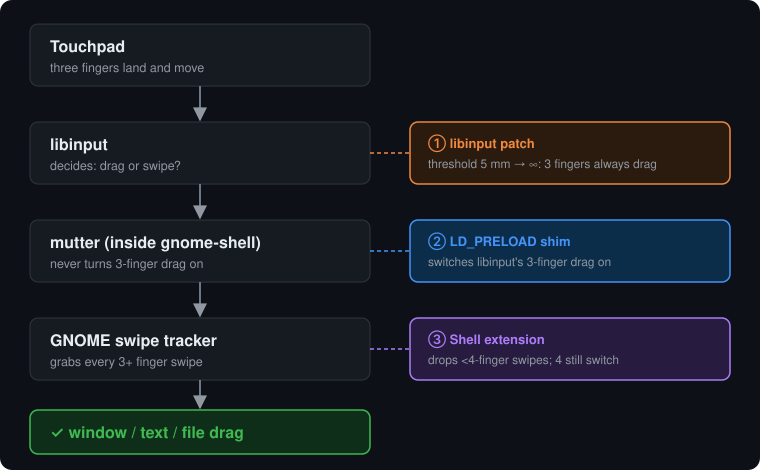

# 3-finger drag for GNOME on Wayland

macOS-style **three-finger drag** on GNOME Shell under Wayland: rest three fingers on the touchpad and move to drag windows, select text or move files, with no clicking. Four-finger swipes still switch workspaces.

GNOME has no setting for this, and no extension provides it for Shell 50. This repo gets it working with three small pieces. You need all three, because each one fixes a different layer.

Tested on **Ubuntu 26.04, GNOME Shell 50.1, mutter 18, libinput 1.31.1** on an HP laptop touchpad. The 3-finger-drag API arrived in libinput **1.28**. The drag-or-swipe threshold that the patch changes was only added in **1.31**, so on 1.28–1.30 skip step 3 and see whether the shim and the extension alone are enough. Nothing other than the setup above has been tested.

## Why it doesn't work out of the box

1. **libinput already supports 3-finger drag, but mutter never switches it on.** libinput has `libinput_device_config_3fg_drag_set_enabled()` with a full macOS-style state machine. mutter never calls it (`nm -D --undefined-only libmutter-18.so.0 | grep 3fg` → nothing), so the default, *disabled*, stays in force.
2. **libinput's drag-or-swipe guess often picks swipe.** 80 ms after three fingers land, libinput checks how far they have moved. At ≥ 5 mm (`DRAG_3FG_OR_SWIPE_MOVE_THRESHOLD`) it decides you're swiping, not dragging. Grabbing a titlebar at normal speed easily moves 5 mm, which is why it "works sometimes".
3. **GNOME takes every swipe of 3 or more fingers** for workspace switching (`swipeTracker.js`, `GESTURE_FINGER_COUNT = 3`), which swallows the drag.

## The fix



| Piece | What it does |
|---|---|
| [`shim/3fgdrag.c`](shim/3fgdrag.c) | `LD_PRELOAD` library for gnome-shell. It hooks `libinput_device_config_tap_set_enabled()`, which mutter *does* call for every touchpad, and switches 3-finger drag on at the same time. It re-checks the setting every 500 dispatches. |
| [`libinput/libinput-3fg-threshold.patch`](libinput/libinput-3fg-threshold.patch) | One-line patch: raises the 5 mm threshold so that 3 fingers **always** drag. It's built into a private copy that only gnome-shell loads. **Your system libinput is not touched.** |
| [`extension/threefingerdrag@local`](extension/threefingerdrag@local) | GNOME Shell extension that drops touchpad swipes with fewer than 4 fingers before GNOME's gesture tracker sees them. The drag itself arrives as ordinary pointer events and isn't affected. |
| [`systemd/3fgdrag.conf`](systemd/3fgdrag.conf) | systemd user drop-in that applies the shim and the patched library to gnome-shell only. |

## Install

```sh
# 1. Build dependencies (and enable deb-src in /etc/apt/sources.list.d/*.sources for step 3)
sudo apt install build-essential libinput-dev meson ninja-build

# 2. Shim
mkdir -p ~/.local/lib
gcc -shared -fPIC -O2 -o ~/.local/lib/3fgdrag.so shim/3fgdrag.c -ldl

# 3. Patched libinput. The version must match your distro's libinput
mkdir -p ~/src-libinput && cd ~/src-libinput && apt-get source libinput
cd libinput-*/
patch -p0 src/evdev-mt-touchpad-gestures.c < /path/to/repo/libinput/libinput-3fg-threshold.patch
meson setup build --prefix=$HOME/.local/lib/libinput-3fg \
  -Dtests=false -Ddocumentation=false -Ddebug-gui=false -Dbuildtype=release
ninja -C build && ninja -C build install

# 4. Extension
cp -r extension/threefingerdrag@local ~/.local/share/gnome-shell/extensions/
gsettings get org.gnome.shell disable-user-extensions   # must print false
gnome-extensions enable threefingerdrag@local

# 5. Hook it into gnome-shell
mkdir -p ~/.config/systemd/user/org.gnome.Shell@ubuntu.service.d
cp systemd/3fgdrag.conf ~/.config/systemd/user/org.gnome.Shell@ubuntu.service.d/
systemctl --user daemon-reload
```

Then **log out and log back in**. If the patch doesn't apply to your libinput version (1.31 or later), edit the `DRAG_3FG_OR_SWIPE_MOVE_THRESHOLD` line in `src/evdev-mt-touchpad-gestures.c` by hand. It's a single `#define`.

Not on Ubuntu? Find the name of your shell's unit with `systemctl --user list-units 'org.gnome.Shell*'` (often `org.gnome.Shell@wayland.service`) and use that as the drop-in directory. On non-x86_64 systems, fix the `LD_LIBRARY_PATH` multiarch directory in `3fgdrag.conf`.

## Check that it worked

```sh
journalctl --user -b | grep 3fgdrag
```

You should see `[3fgdrag] set 3fg=1 ...` from the shim and `capture-phase filter installed` from the extension.

## Gotchas (each of these cost hours)

- **Overriding `TouchpadSwipeGesture.prototype._handleEvent` in an extension does nothing.** GNOME binds it with `.bind(this)` in `_init()`, before any extension loads. Filter in the capture phase on `global.stage` instead, which is what the extension here does.
- **`disable-user-extensions = true` fails silently.** `gnome-extensions enable` reports success, the extension stays `INITIALIZED`, and system extensions keep working, so nothing looks broken.
- **A separate test program can't confirm the setting.** libinput device config belongs to each libinput context, so another process sees its own fresh defaults. Trust the shim's log line instead.
- **Every change needs a full logout.** Shell 50 has no way to reload extensions, and libraries load when the process starts. Check gnome-shell's PID or start time before believing any test result.

## Updates and removal

- When the distro updates libinput, gnome-shell keeps using the old patched copy. That's safe, because nothing breaks. After a **major** libinput update, rebuild step 3.
- **Uninstall:** delete the drop-in, `systemctl --user daemon-reload`, `gnome-extensions disable threefingerdrag@local`, log out. Remove all of this once GNOME supports 3-finger drag natively.

## Not possible: two-finger back/forward

libinput always treats two fingers as scrolling (`finger_count == 2 → GESTURE_EVENT_SCROLL_START`), so a 2-finger swipe reaches apps as horizontal scrolling, never as a gesture. Only 3 or more fingers can ever produce a swipe. Use `Alt+←/→` or the mouse's side buttons instead.

## License

MIT. See [LICENSE](LICENSE). The patch modifies libinput, which is also MIT-licensed.
